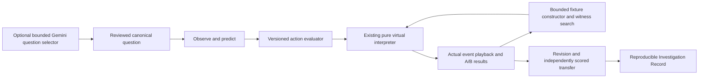

# Project report — ShellForge, The Almost Right Lab

## Objective

Help an OS student distinguish near-identical command behavior using inspectable
metadata, explicit prediction, deterministic evidence and a later transfer problem.
The educational objectives are GNU find unit rounding and inequalities, directory
read/search separation, ownership/sticky unlink rules, and verification of model
output against an explicit contract. Software completion is not evidence that
students learned more; no participant study has been conducted.

## Implemented system

The existing Next.js/React and FastAPI product was extended, preserving its pure
26-entry filesystem interpreter, static safety analyzer, scheduler, selected Qwen
runtime path and historical datasets/evaluations. The new entry is a case gallery
with four complete investigations; the previous command workshop moved to
`/workshop`. A direct no-login route opens the flagship at `/cases/missing-100`.

The architecture is:

The learner never executes a shell command. File objects, permission checks and
animations share real interpreter events. Native focused dialogs, hypothesis
continuity, clickable modifiers, state-driven file transitions and witness replay
support the evidence, while reduced-motion and keyboard paths retain functionality.

## Algorithms and contracts

The witness engine derives candidate paths, threshold-adjacent sizes, names and
mode/ownership profiles from the command pair. It evaluates a capped finite domain
and returns the first difference under a declared cost ordering and observable
definition. Certificates describe exact bounds and limited minimality. No witness
is never interpreted as general equivalence. Full details and edge cases are in
`ALMOST-RIGHT-LAB.md`.

The session evaluator validates actions, preserves the first answer, independently
scores revised/transfer predictions, and recovers local progress by action replay.
Export includes the initial fixture, both results/traces, generated witness,
source/evaluator versions, first/revised answers, hint usage, genuine model source
and transfer evidence. The verifier recreates derived results; it is not a signed
exam credential.

Beat the Model uses one actual primary-cohort rank-16 output. Its reviewed scope is
an explicit saved-reference predicate mismatch. Ambiguous original MB wording is
shown, and other nonexact outputs are not declared semantic failures by inference.
Original primary results remain **84/1,222 (6.87%) strict exact match**, separate
from the historical pilot and authored safety benchmark.

The optional Gemini integration can select only one of three reviewed questions.
Canonical facts are generated from the same evaluator, not supplied by a learner
or invented by a model. It cannot grade, alter state or render arbitrary model
prose. It is disabled by default, bounded by an explicit 0–20 process-lifetime
request budget, one active request, rate/byte/token/time limits and strict response
validation. It has a deterministic offline fallback.

## Measured implementation outcomes

- Four finished cases: size boundary, directory search, sticky unlink, genuine
  model predicate repair; each has a distinct withheld transfer fixture.
- 146 Node tests passed; 120 focused Python tests passed.
- 41 development and 41 optimized-production Chromium browser checks passed.
- Lint, TypeScript and production compilation passed.
- All four complete teaching episodes, witness replay, actual export, persistence,
  mobile/reduced-motion and native keyboard focus behavior verified.
- The actual browser-downloaded flagship record independently replayed against the
  source evaluator. Desktop/mobile screenshots and a real recording are retained
  under `docs/visual-qa/almost-right/`.

These are correctness/interaction measurements, not learning-gain measurements.
No generated screenshot or provider mock is used as real deployment/model evidence.
Public release identity is checked separately against PR head and both hosting
providers; `/api/version` and `/api/health` expose non-secret commit identities.

## Scope and limitations

The interpreter is metadata-only and intentionally narrower than Linux/POSIX:
fixed student identity, no real disk, symlinks, ACLs, arbitrary shell, mounts or
interactive rm prompts; bounded atomic operations instead of real rm partial
failure behavior. Search is finite and incomplete outside its declared domain.
Progress is local and inspectable, not a secure test or cloud record. Reset clears
a case's history unless exported. There is no participant assessment, account,
leaderboard or fabricated mastery claim.

The existing CPU scheduler remains available but has no new prediction lesson.
Four verified cases were preferred over six shallow ones. Gemini live success
requires an owner-configured server key; none is claimed in this delivery. The
separate authenticated Qwen runtime remains supported, but an always-on public
model runtime is not configured and no paid compute was provisioned.

## Prior art and demonstration

`TEACHING-TOOLS-COMPARISON.md` compares primary sources for Python Tutor, OSTEP
VizTools, explainshell and OSTEP. Step visualization, command explanations,
prediction exercises, scheduling and counterexamples are established ideas. The
project-specific contribution is their integrated use with a bounded command
witness constructor, immutable first-answer evidence, transfer scoring and genuine
saved model mistakes under reviewed constraints.

`ALMOST-RIGHT-DEMO.md` provides the reproducible six-minute faculty walkthrough.
`ASSETS-AND-CREDITS.md` records the original image prompt, existing licenses and
interaction references. The original cream/evergreen visual direction was retained.
