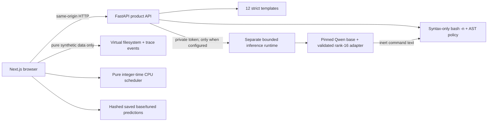

# ShellForge faculty demonstration (6 minutes)

Open the public product and keep the source PR available. No faculty login is
required. The free API may take time to wake; verify its health before presenting.

1. **0:00–0:45 — Boundaries.** ShellForge proposes and explains commands; it never
   executes them. The filesystem is synthetic, with 26 initial entries. The
   analyzer checks Bash syntax and static AST policy separately from simulation.
2. **0:45–2:00 — GNU find.** Open Lab → filesystem. Compare `100M`, `+100M` and
   `104857600c`. Select threshold-99-plus-one.bin: ceil((99 MiB + 1)/MiB)=100,
   so it matches `100M`, although it is not exactly 100 MiB. Step through the
   recorded interpreter events and show the actual predicate calculations.
3. **2:00–3:00 — Permissions and mutation.** Open “Permissions, bit by bit”. On
   /lab/data/nested turn off owner x, apply, observe incomplete traversal, then
   undo. A known pathname needs ancestor x; listing a directory needs r; this
   bounded walker requires r+x to descend. Preview removing root-owned.tmp in
   sticky /lab/tmp, then show its explicit denial. Preview rm -rf ./tmp/cache,
   inspect the diff, apply in memory and undo. Explain atomic preflight differs
   from real rm’s possible partial deletion.
4. **3:00–4:00 — Scheduling.** Open “Who gets the CPU?”. Default SRTF gives A0–1,
   B1–3, C3–4, A4–8. Step the real CPU timeline; compare FCFS. Waiting equals
   completion − arrival − burst. Response is first start − arrival. RR quantum
   affects the computed schedule; arrivals at a boundary enqueue before expired
   work. Priority is non-preemptive; lower numbers win. Idle transitions and
   self reselections do not count as process-to-process context switches.
5. **4:00–5:15 — ML evidence.** Open Model Studio. Show the honest 0–100% chart:
   base 28/1,222 (2.29%), selected rank-16 84/1,222 (6.87%). Explore real paired
   failures and source hashes. The 32 exposed pilot cases are excluded from this
   primary cohort. Pilot 3/32 versus 2/32 is preserved separately. Show the actual
   CPU inference smoke and browser response evidence. Public Saved Evaluation
   remains available; Live is enabled only when a real authenticated runtime is
   reachable. Do not claim the public site has an always-on GPU.
6. **5:15–6:00 — Architecture and limitations.** Show the diagram below and tests.
   Parsing is not semantic correctness. The 0.9817 safety F1 belongs to a separate
   102-case authored benchmark. No real processes, links, ACLs, mounts or file
   contents are simulated. Page replacement was deferred to preserve verified
   scope. The new Colab inference notebook is reproducible; this sprint’s actual
   smoke was CPU, not a claimed GPU run.

## Likely viva questions

- **Is this a real shell?** No. A strict grammar interprets synthetic data only;
  unsupported shell syntax is rejected. The analyzer invokes Bash only with -n
  for syntax, never to execute a generated command.
- **What does -size 100M mean?** Ceil(logical bytes/1,048,576) equals 100. `+100M`
  compares that rounded count greater than 100; `c` uses one-byte units.
- **Can you delete a read-only file?** In the model, unlink depends on parent w+x
  and sticky ownership, not the file’s write bit. Real systems may add ACL/mount
  restrictions that are outside this model.
- **Why can metadata be visible while traversal fails?** Known-entry metadata
  and directory enumeration differ. The fixture viewer is omniscient synthetic
  data; the interpreter separately applies the fixed student identity.
- **Is a SAFE prediction correct?** No. SAFE is an allowlist policy label; syntax,
  policy, simulation support and intent correctness are distinct properties.
- **Did tuning solve command generation?** No. Strict exact match improved but
  remains low. Equivalent commands may miss; syntactically valid commands can
  still be wrong. One successful smoke is not an accuracy estimate.
- **Why not load the model on Render?** The existing free API has 512 MB RAM.
  Model serving is isolated and authenticated; no paid GPU was provisioned.
- **What prevents misleading replays?** Saved Evaluation has record IDs and
  artifact hashes; Live needs an actual reachable provider and a complete result.
  Errors never silently substitute a saved output.
- **What makes scheduling deterministic?** Integer arrivals/bursts, one CPU,
  zero dispatch overhead, explicit tie order, explicit preemption policies and
  bounded input. Tests include independent hand-calculated schedules and metrics.
