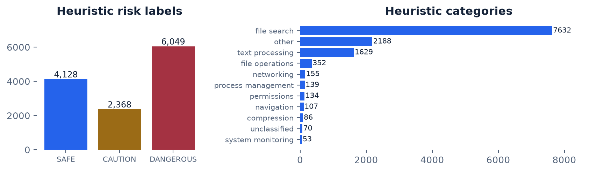
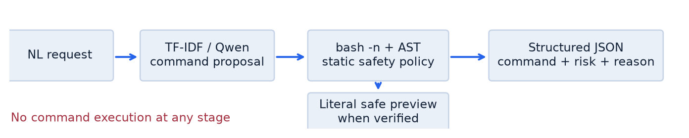
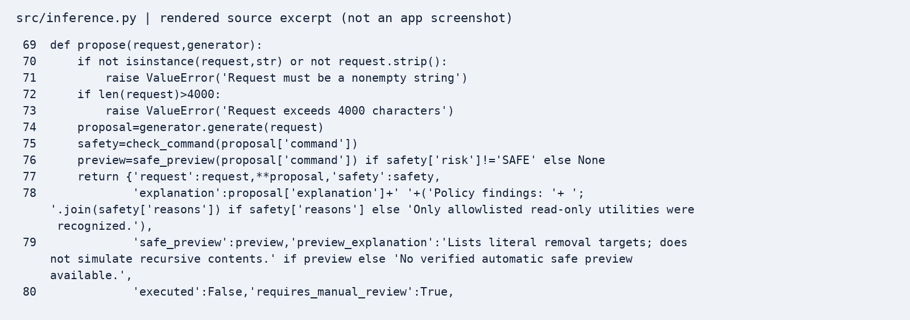
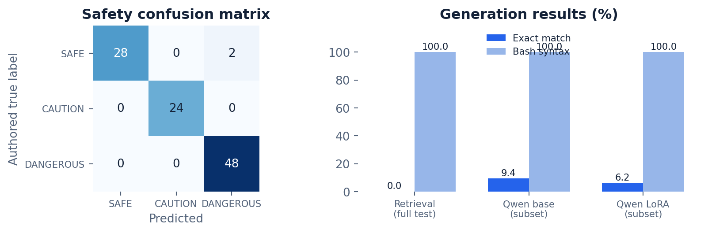

# ShellForge - Review 2

Completed full-data T4 GPU experiment, verified 16 October 2026. Runtime source: 8a2619299bd553136ddb4dc2a8dbeb939dae494f. Report builder correction: d057349857bcd71397d40f4c692b59cda718a497. Branch: codex/review2-cloud.

Repository: https://github.com/rupeshhh007/ShellForge

## 1. Dataset

The original NL2Bash corpus has 12,607 natural-language lines and 12,607 command lines. The repository also has 20 curated records, a 100-row import, 120-row pilot and old 96/12/12 splits. All original data and Review 1 documentation were preserved. Review 2 ingested 12,967 occurrences across the corpus and original JSONL files. Count equality and source SHA-256 hashes establish positional consistency, not universal semantic alignment. Original risk annotations remain unverified; independently verified corpus risk labels: 0.

## 2. Dataset Preprocessing

Typed JSON validation rejects malformed objects, missing/non-string/empty required fields and NULs. Command bytes, case, quotes and internal spacing are preserved. Syntax checks use Bash parse-only mode with a clean environment. Removed 348 duplicate occurrences and 74 syntax-invalid occurrences; retained 12,545. Connected components isolate shared normalized instructions, AST literal quote/spacing equivalents and known additive ls/rm flag variants. Seed 42 yields 9,328 groups (largest 45); splits 10,036/1,255/1,254. All checked cross-split overlaps are zero. Arbitrary semantic paraphrase leakage is not ruled out. Follow-up training-only audit retained 10,026/10,036 examples; additional exclusions 10. A 100-pair assistant static review identified ten wrong paths, time predicates, unsupported tasks or unintended actions; labels are not externally adjudicated. Original split membership and held-out bytes remain unchanged.

## 3. Code Implementation

A training-only character TF-IDF retrieval baseline and optional Qwen Transformers generator feed the same static validator and structured JSON CLI. The validator handles deletion flag variants, find actions, file truncation, formatting, privilege changes, broad permissions, termination, wrappers, interpreters, substitutions and dangerous pipelines. Unknown utilities require review; unsupported shell constructs fail closed. A preview is emitted only for simple literal recursive rm and is revalidated as read-only. Other cases explicitly return no verified preview. Every response records executed=false and requires manual review. Completed a small CPU LoRA pilot: 20 optimizer steps, rank 8, alpha 16, q_proj/v_proj; 540,672 trainable parameters (0.1093%). Used 128 of 128 selected training examples; 0 exceeded the 192-token limit. Validation loss: 1.3759. This is a feasibility run, not a fully trained production model. New measured run: 10,026 encoded training examples, 1500 optimizer steps, 2.393 epochs; rank 16, attention/MLP LoRA, LR 5e-05, effective single-GPU batch 16. Trainer invocation loss 0.2582 (not a full-run mean after resume); initial validation loss 1.6636; selected loss 0.9903. Full validation selects trials; test is evaluated after selection.

## 4. Metrics - Results and Discussion

Original results are retained in the table below.  New primary test: 1222 cases unexposed to the old pilot. Base 28/1222; tuned 84/1222; delta +4.58 percentage points, paired exact McNemar p=0.0000. Wilson intervals, normalized match, AST support, syntax and heuristic categories are in comparison.json. AST overlap does not prove semantics. The full 1,254-case comparison includes 32 previously exposed pilot cases.

| Model / evaluation scope | n | Exact match | Bash syntax |
| --- | --- | --- | --- |
| TF-IDF 1-NN / full test | 1254 | 0.00% | 100.00% |
| Qwen base / subset | 32 | 9.38% | 100.00% |
| Qwen LoRA / same subset | 32 | 6.25% | 100.00% |
| New base / unexposed | 1222 | 2.29% | 98.20% |
| New LoRA / unexposed | 1222 | 6.87% | 99.35% |

| Safety class | Precision | Recall | F1 | Support |
| --- | --- | --- | --- | --- |
| SAFE | 1.000 | 0.933 | 0.966 | 30 |
| CAUTION | 1.000 | 1.000 | 1.000 | 24 |
| DANGEROUS | 0.960 | 1.000 | 0.980 | 48 |

Example (exact-match success): Make directory "temp"
Reference: `mkdir temp`
Prediction: `mkdir temp`

Example (exact-match failure): Find all files starting from the current directory which are exactly 100MB in size
Reference: `find . -size 100M`
Prediction: `find . -size +100M`

## 5. What Went Wrong

The original importer could silently truncate unequal files; old random splits leaked shared commands/instructions. Retrieval produced zero held-out exact matches, showing its inability to synthesize unseen commands. The initial safety benchmark missed date -s and chmod ugo=rwx (two dangerous false negatives); both were fixed while preserving initial scores. Two harmless compound examples remain rejected by the conservative policy. Direct git clone failed authentication; connector access recovered the repository. Initial model-client dependencies were incompatible with the available proxy; pinned compatible versions resolved access. An initial training run was interrupted to finalize stronger split equivalence, then restarted on final artifacts. The 20-step CPU pilot uses very little data and cannot establish robust model quality. LoRA exact match decreased from 3/32 to 2/32; a completed training run is not proof of improvement. New validation exact match improved; unexposed test exact match increased. No predetermined improvement or semantic-equivalence claim is made.

## 6. Alternative Flow / Proposed Improvements

The completed run uses validation-selected checkpoints and trial settings. Remaining work: human semantic adjudication, a fresh external safety benchmark, model-capacity comparisons against each model own base, and calibrated abstention. Keep generated execution disabled. Logs, loss history, hashes and the selected adapter are retained in the cloud experiment folder.

## Verification and reproduction

61 passed, 32 warnings in 42.80s

See README.md for exact cloud commands. See reports/logs/commands.txt, data/review2/stats.json, reports/metrics/ and artifacts/qwen-lora/training_manifest.json for detailed evidence.

References: NL2Bash, Lin et al. (2018), https://github.com/TellinaTool/nl2bash; Qwen2.5-0.5B-Instruct model card, https://huggingface.co/Qwen/Qwen2.5-0.5B-Instruct; LoRA, Hu et al. (2021), https://arxiv.org/abs/2106.09685. Model revision: 7ae557604adf67be50417f59c2c2f167def9a775.
